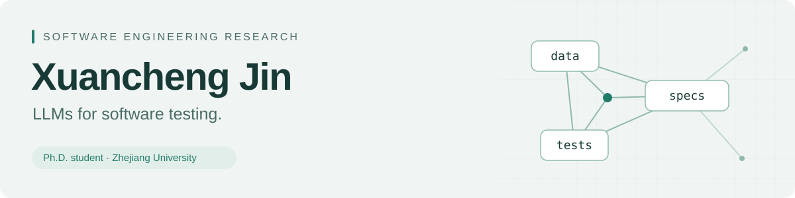

<picture>
  <source media="(prefers-color-scheme: dark)" srcset="assets/header-dark.svg">
  <source media="(prefers-color-scheme: light)" srcset="assets/header-light.svg">
  
</picture>

# Xuancheng Jin

I am a Ph.D. student at the School of Software Technology, Zhejiang University, advised by [Prof. Xing Hu](https://xing-hu.github.io/).

My research focuses on LLM-driven software testing, particularly how program structure and execution evidence can inform test generation. I study test-to-code traceability, specification inference, and property-based testing, with the aim of grounding generated tests in program behavior.

I am also interested in extending executable properties to the evaluation of agent trajectories and investigating their role in reinforcement learning feedback.

[Website](https://xc-jin.github.io/) · [Email](mailto:xc.jin@zju.edu.cn) · [GitHub](https://github.com/xc-jin) · [Research](#research)

## Research interests

LLM4Test · Test4LLM

## Research

### TRACETS4J: A Traceable Unit Test Generation Dataset

SANER 2025 · First author  
[Paper](https://ieeexplore.ieee.org/document/10992478/) · [Code & dataset](https://github.com/xc-jin/TRACETS4J)

Inaccurate associations between tests and focal methods introduce noise into test generation datasets. This work studies the causes of incorrect and missed traceability links and proposes COACH, an approach that combines hierarchical matching heuristics with signature validation.

Applying COACH to 19,518 open-source Java projects yields TRACETS4J, a dataset of 1,115,654 test–method pairs. Experiments with CodeT5 fine-tuning examine the dataset's utility for unit test generation.

